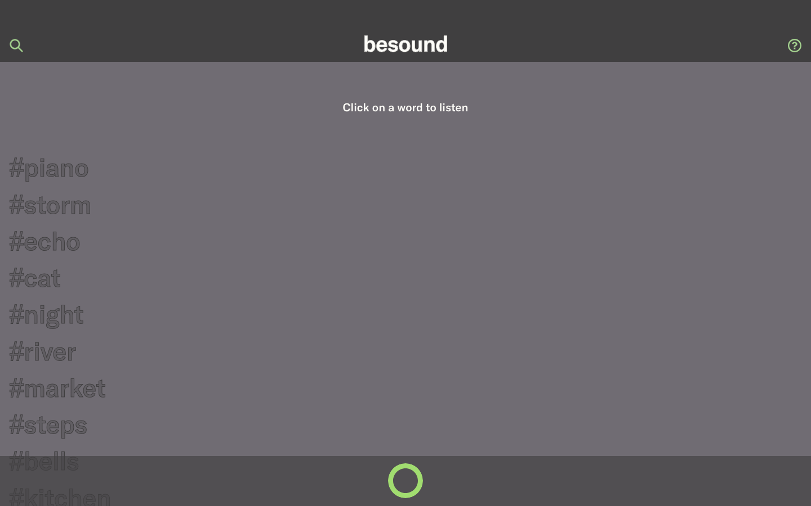

# besound

[English](README.md) · [Español](README.es.md)



besound es una web para compartir experiencias sonoras breves. Cualquiera puede entrar y escuchar los sonidos que han grabado otras personas, cada uno identificado con una sola palabra. Los usuarios registrados graban hasta 15 segundos de audio desde el navegador, le ponen un título y lo publican, y pueden borrarlo después si se arrepienten.

Este repositorio es el **back-end**: una API REST hecha con Django que gestiona los usuarios, la autenticación y la subida de audios, además de un admin desde el que se editan todos los textos de la web sin tocar código. El front-end es una app de Next.js que está en [besound-front](https://github.com/edealfonso/besound-front).

## Funcionalidades

- **API REST** para registrarse, iniciar sesión con token, y listar, subir y borrar sonidos.
- **Contenido editable**: todos los textos de la web (inicio, login, registro, grabación y «about») son modelos únicos en el admin de Django, con editor de texto enriquecido para las instrucciones de grabación.
- **Subidas seguras**: los audios se validan por su contenido real (WebM, MP4/M4A, MP3, OGG, WAV) y por tamaño, no por el nombre ni el tipo que declara el navegador.
- **Propiedad**: solo el autor puede borrar un sonido, y al borrarlo también se elimina el archivo del disco.
- **Paginación opcional** de la lista de sonidos con `?limit=&offset=`.
- **Docker**: PostgreSQL, gunicorn y nginx arrancan con un solo comando para desarrollar en local.
- **Despliegue gratis**: la API en Render, la base de datos en Neon y los audios en Cloudflare R2, con un Blueprint de Render (`render.yaml`) que lo crea casi todo solo.
- **Seguro por defecto**: secretos fuera del repo, CORS limitado al front-end, redirección a HTTPS, cookies seguras y HSTS en producción.
- **Con tests**: registro, validación de audios, paginación y borrado.

## Tecnologías

| Área | Tecnologías |
|---|---|
| Back-end | Python 3.12, Django 5.2 LTS, Django REST Framework, PostgreSQL 16 (psycopg 3), django-solo, django-ckeditor-5, django-cors-headers |
| Front-end ([besound-front](https://github.com/edealfonso/besound-front)) | Next.js, React, Sass, API MediaRecorder |
| Almacenamiento | Cloudflare R2 para los audios (django-storages, API S3), whitenoise para los estáticos |
| Infraestructura | Docker, Docker Compose, gunicorn, nginx (local) · Render (API), Neon (PostgreSQL), Vercel (front-end) |

## Cómo ejecutarlo

Solo necesitas [Docker](https://docs.docker.com/get-docker/) (con Compose v2).

```bash
git clone https://github.com/edealfonso/besound.git
cd besound
cp .env.example .env   # pon DJANGO_DEBUG=1 para probarlo en http://localhost
docker compose up -d --build
docker compose exec web python manage.py createsuperuser
```

La API queda en http://localhost:8000/v1/ y el admin en http://localhost:8000/admin/. Si el puerto 8000 está ocupado, usa otro: `BESOUND_PORT=8080 docker compose up -d`.

Para usar el front-end con este back-end, clona [besound-front](https://github.com/edealfonso/besound-front) y arráncalo con `BACKEND_SERVER=http://localhost:8000/ npm run dev`.

Para lanzar los tests:

```bash
docker compose exec web python manage.py test apps
```

## Despliegue

Guía paso a paso para publicarlo gratis con Render (API), Neon (PostgreSQL) y Cloudflare R2 (audios), sin tarjeta y sin administrar servidores: [docs/DESPLIEGUE.md](docs/DESPLIEGUE.md).

Alternativa para un servidor propio (VPS, Oracle Cloud…) con Docker Compose y Caddy, con sitio para varios proyectos: [docs/DESPLIEGUE-SERVIDOR-PROPIO.md](docs/DESPLIEGUE-SERVIDOR-PROPIO.md).

## API

| Método | Endpoint | Auth | Descripción |
|---|---|---|---|
| GET | `/v1/home`, `/v1/about` | – | Textos de la página |
| GET / POST | `/v1/register` | – | Textos / crear un usuario |
| GET / POST | `/v1/login` | – | Textos / obtener un token (`username` = email) |
| GET | `/v1/posts/list` | – | Todos los sonidos. Con `?limit=20&offset=0`, respuesta paginada |
| GET / POST | `/v1/posts/new` | Token | Textos / subir un sonido (`title`, `audio`; máx. 10 MB) |
| DELETE | `/v1/posts/delete/<id>` | Token | Borrar uno de tus sonidos |

Las peticiones autenticadas llevan la cabecera `Authorization: Token <token>`.

## Demo

La demo online en [besound.vercel.app](https://besound.vercel.app/) está caída de momento: el front-end sigue en Vercel, pero el servidor donde estaba esta API ya no responde. La captura de arriba está hecha ejecutando los dos proyectos en local con datos de ejemplo.

## Mi contribución

- En 2023 diseñé y desarrollé besound: esta API REST con Django y el [front-end con Next.js](https://github.com/edealfonso/besound-front).
- En 2026 lo actualicé y mejoré con la ayuda de [Claude Code](https://claude.com/claude-code): Docker, correcciones de seguridad, Django 5.2 LTS, validación de audios, paginación y tests. Detalles en el [historial de versiones](CHANGELOG.md).

## Próximos pasos

- [ ] Volver a desplegar la API para que funcione la demo online
- [ ] CI con GitHub Actions: lanzar los tests en cada push
- [x] Guardar los audios en un almacenamiento de objetos (Cloudflare R2) en vez de en el disco del servidor
