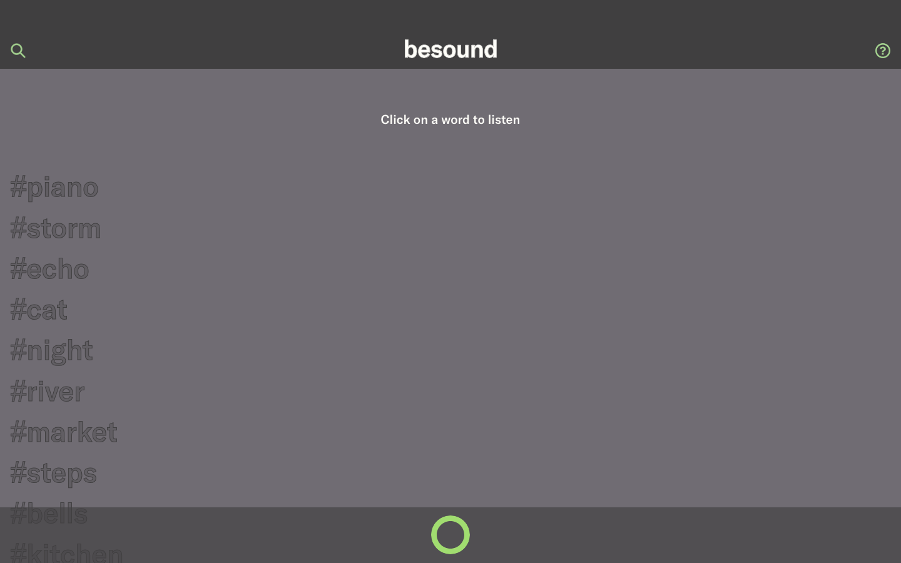

# besound

[English](README.md) · [Español](README.es.md)



besound is a web app for sharing short sound experiences. Anyone can open the site and listen to the sounds other people have recorded, each labelled with a single word. Registered users record up to 15 seconds of audio from the browser, give it a title and publish it, and can delete it later if they change their mind.

This repository is the **back-end**: a REST API built with Django that handles users, authentication and audio uploads, plus an admin where every text shown in the app can be edited without touching code. The front-end is a Next.js app in [besound-front](https://github.com/edealfonso/besound-front).

## Features

- **REST API** for registration, token login, and listing, uploading and deleting sounds.
- **Editable content**: every text of the app (home, login, register, record and about pages) is a singleton model in the Django admin, with a rich text editor for the recording instructions.
- **Safe uploads**: audio files are validated by their real content (WebM, MP4/M4A, MP3, OGG, WAV) and by size, not by the name or type the browser declares.
- **Ownership**: only the author can delete a sound, and its file is removed from disk too.
- **Optional pagination** of the sound list with `?limit=&offset=`.
- **Docker**: PostgreSQL, gunicorn and nginx start with one command.
- **Secure by default**: secrets out of the repo, CORS limited to the front-end, HTTPS redirect, secure cookies and HSTS in production.
- **Tested**: registration, upload validation, pagination and deletion.

## Tech stack

| Area | Technologies |
|---|---|
| Back-end | Python 3.12, Django 5.2 LTS, Django REST Framework, PostgreSQL 16 (psycopg 3), django-solo, django-ckeditor-5, django-cors-headers |
| Front-end ([besound-front](https://github.com/edealfonso/besound-front)) | Next.js, React, Sass, MediaRecorder API |
| Infrastructure | Docker, Docker Compose, gunicorn, nginx, Vercel (front-end) |

## Quick start

Requires only [Docker](https://docs.docker.com/get-docker/) (with Compose v2).

```bash
git clone https://github.com/edealfonso/besound.git
cd besound
cp .env.example .env   # set DJANGO_DEBUG=1 to try it on http://localhost
docker compose up -d --build
docker compose exec web python manage.py createsuperuser
```

The API is at http://localhost:8000/v1/ and the admin at http://localhost:8000/admin/. If port 8000 is taken, use another one: `BESOUND_PORT=8080 docker compose up -d`.

To run the front-end against it, clone [besound-front](https://github.com/edealfonso/besound-front) and start it with `BACKEND_SERVER=http://localhost:8000/ npm run dev`.

Run the tests with:

```bash
docker compose exec web python manage.py test apps
```

## Deployment

Step-by-step guide (in Spanish) to deploy it for free on an Oracle Cloud VM, with HTTPS and room for more projects: [docs/DESPLIEGUE.md](docs/DESPLIEGUE.md).

## API

| Method | Endpoint | Auth | Description |
|---|---|---|---|
| GET | `/v1/home`, `/v1/about` | – | Page texts |
| GET / POST | `/v1/register` | – | Page texts / create a user |
| GET / POST | `/v1/login` | – | Page texts / get a token (`username` = email) |
| GET | `/v1/posts/list` | – | All sounds. With `?limit=20&offset=0`, a paginated response |
| GET / POST | `/v1/posts/new` | Token | Page texts / upload a sound (`title`, `audio`; max 10 MB) |
| DELETE | `/v1/posts/delete/<id>` | Token | Delete one of your sounds |

Authenticated requests send the header `Authorization: Token <token>`.

## Demo

The online demo at [besound.vercel.app](https://besound.vercel.app/) is currently offline: the front-end is still on Vercel, but the server that hosted this API is down. The screenshot above was taken running both projects locally with sample data.

## My contribution

- In 2023 I designed and built besound: this Django REST API and the [Next.js front-end](https://github.com/edealfonso/besound-front).
- In 2026 I updated and improved it with the help of [Claude Code](https://claude.com/claude-code): Docker, security fixes, Django 5.2 LTS, upload validation, pagination and tests. See the [changelog](CHANGELOG.md).

## Roadmap

- [ ] Deploy the API again so the online demo works
- [ ] CI with GitHub Actions: run the tests on every push
- [ ] Store audio files in object storage (S3 compatible) instead of the server disk
